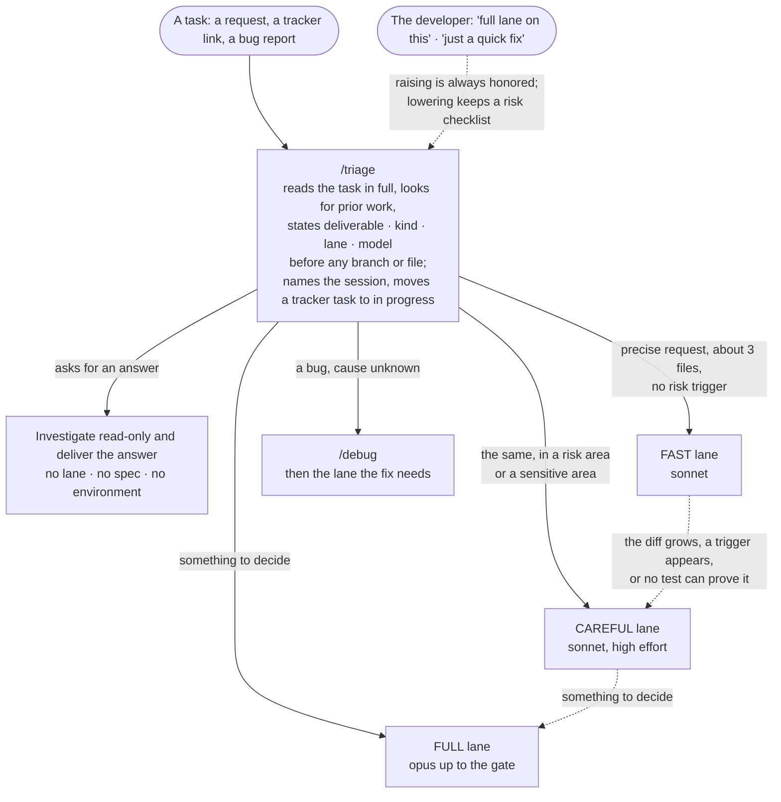
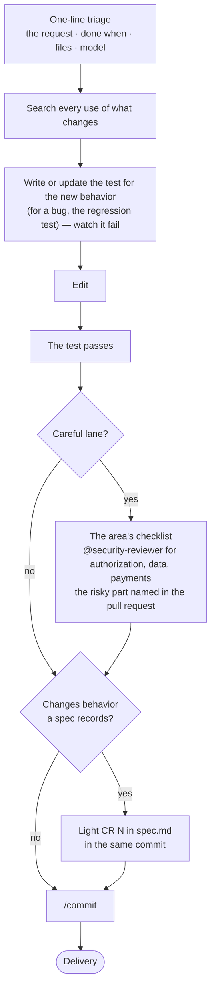
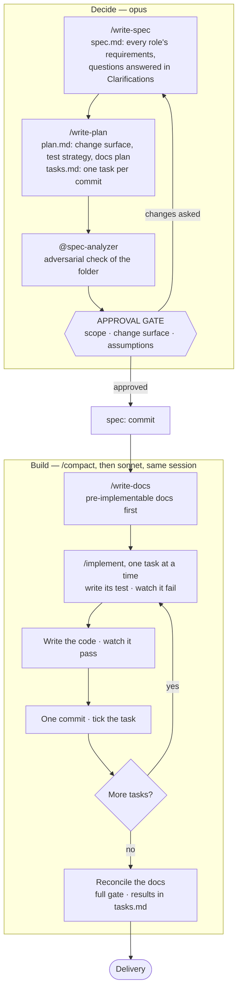
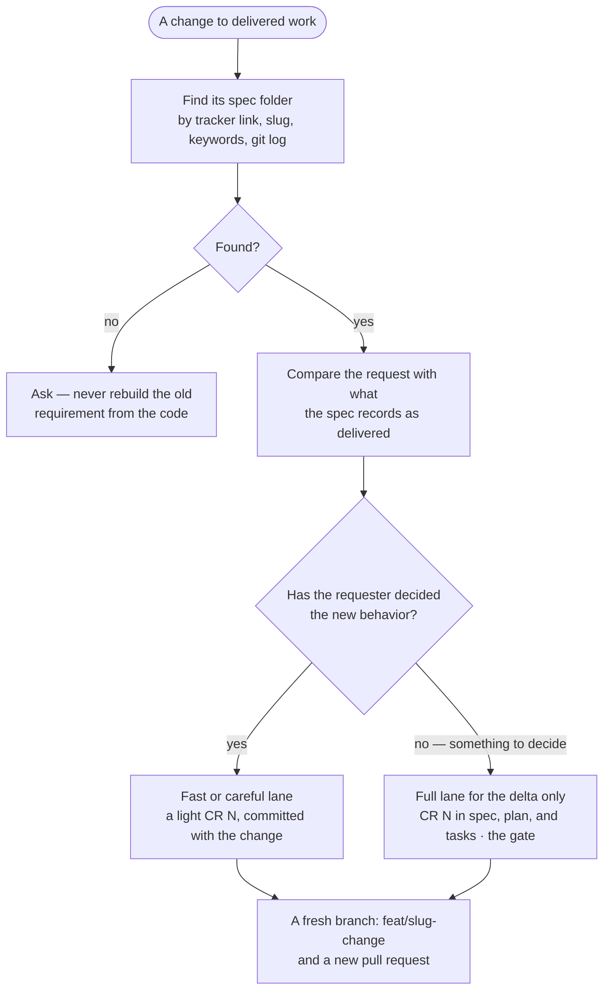

# Agentic Development Framework

> **AI agents:** asked to adopt, use, or install this framework in a project? Follow
> [ADOPT.md](ADOPT.md) (raw: `https://raw.githubusercontent.com/aplyca/AgenticDevelopmentFramework/main/ADOPT.md`)
> — don't copy files from this repository by hand.

A production-grade framework for professional **multi-perspective spec-driven, test-driven, docs-first AI-assisted development.** It ships as a portable project skeleton you drop into any codebase, optional modules for your Git host, your stack, and your ways of working, and an installer plugin for Claude Code. It includes an enforced multi-perspective spec model, specialized agents, workflow skills, multi-agent workflows, and guardrail hooks. Engineering standards and a team onboarding path are part of it too.

The framework is built on three reinforcing disciplines:
- **Multi-perspective spec-driven design** — every feature's spec captures input from all relevant roles (business, functional, security, accessibility, privacy, design, performance, and more), with required sections enforced. The plan that follows names the exact **change surface**, and nothing is implemented until a human approves it.
- **Test-driven development** — every task names the test that proves it; the test is written and **seen failing** before the code that makes it pass, and each task lands as one commit.
- **Docs-first delivery** — user-facing docs (admin guides, API contracts, end-user copy) are written from the spec and plan before implementation, and deliberately updated when reality shifts — living artifacts, never frozen contracts.

How much of that a change gets follows its risk, not its size: a precise fix goes through a fast lane and is proved by a test, and the full spec flow is kept for changes with something to decide. The model follows the work the same way — Sonnet for well-specified work, Opus for judgment.

Works with Claude Code natively; supports Cursor, Antigravity, GitHub Copilot, Codex, Aider, and Windsurf via the [AGENTS.md](https://agents.md) standard, and Gemini CLI through a settings file that points it there.

Most of what's here was proven in real client projects first — some built on this framework, some grown alongside it — and then generalized. The reasoning behind each decision is in [`docs/decisions/`](docs/decisions/README.md).

## What's included

- **Spec folders** — `specs/NNN-<slug>/` with `spec.md` (the multi-perspective WHAT and WHY), `plan.md` (constitution check, change surface, test strategy, documentation plan, assumptions), and `tasks.md` (one task per commit, each naming its test, plus recorded gate results). Change requests amend the same folder. ([Process](skeleton/specs/README.md) · [Spec model](plugins/adf/docs/SPEC-MODEL.md))
- **Three lanes — ceremony follows risk, not size** — fast (a precise change, proved by a test), careful (a risk area: plus its checklist, and the risky part named for the developer's test), and full (something to decide: the spec-driven flow). `/triage` states the lane before the first edit, the developer can always raise it, and sensitive areas are configuration, enforced by a hook. ([Lanes](skeleton/specs/README.md#lanes--how-much-process-a-change-gets) · [why](docs/decisions/0011-lanes-ceremony-follows-risk.md))
- **The model follows the work** — `sonnet` when the task has a clear spec and a way to check the result (the fast and careful lanes, bug fixes, reviews, implementing an approved plan), `opus` for judgment (the full lane's spec and plan, a bug that resists diagnosis). Version-less aliases throughout; `/triage` names the model, and agents carry their own. ([Choosing a model](plugins/adf/docs/COST-MODEL.md#choosing-between-sonnet-and-opus) · [why](docs/decisions/0012-choose-the-model-by-the-work.md))
- **One approval gate on the change surface** (full lane) — after the plan, before any code: scope, the files and layers the change touches, and every assumption, signed off by a human.
- **21 workflow skills** — triage, spec, plan, tests, docs, implement, review, commit, draft PR, the stakeholder update, handoff, wrap-up after the merge, decision records, context and drift audits, and more — plus `/dispatch` with the `parallel-agents` module, `/dev-env` with `docker`, `/e2e` with `e2e`, `/unit` with `unit`, `/track-time` with `time-tracking`, and `/end-user-docs` with `end-user-docs`. ([Catalog](docs/SKILLS-REFERENCE.md))
- **8 specialized agents**, each on the model its work needs — reviewers on `sonnet`; `@spec-analyzer` (which adversarially checks a spec folder before the gate) and `@architect` on `opus`. ([Catalog](docs/AGENTS-REFERENCE.md))
- **4 dynamic workflows** — `/deep-review`, `/deep-spec-analysis`, `/deep-context-audit`, `/deep-drift-sweep`: deterministic multi-agent fan-outs whose findings are independently verified or cross-checked, each step on a pinned model.
- **Guardrail hooks and permissions** — the rules that must hold every time are configuration, not prose. Ten hooks tell each session its checkout, branch, and spec folder; name the session after its task; say when the branch's pull request merged (offer `/wrap-up`) or closed; remind the agent once to state the triage before its first edit or branch; stop the first edit in each sensitive area once, to confirm the lane; keep the main checkout edit-free when it's the hub (parallel-agents) and approve a session's move into its worktree; block `--no-verify`, commits and pushes on protected branches, and a pull request that isn't a draft; block hand-edits to generated files and existing migrations; and report undeclared env vars. Commits, the work branch's push, its draft pull request, and marking it ready once the agent's own tests pass run without a prompt; merging or reviewing a pull request, releases, and `gh api` writes ask a human first. `.env` files are never read. ([Hooks](plugins/adf/hooks/README.md))
- **9 engineering standards** — code quality (including "write almost no comments"), testing (with test tiers — `@smoke` ⊂ `@critical` ⊂ regression — and feature suites), security, git workflow, plus customizable architecture, UI/UX, deployment, performance, observability.
- **Process records** — a constitution that gates every spec and review, Process Decision Records for how the team works, ADRs for the application, and on-demand code-level reference pages.
- **Optional modules** — `github` (PR template with the lane, traceability, and constitution gates; issue forms, secret scan, base-branch policy), `gitlab` (the same for GitLab: a merge request template, issue templates, and the gates as a CI include), `git-hooks` (tool-agnostic `pre-push`), `clickup` (ClickUp's MCP server, so `/triage` reads tasks directly; a read-only allowlist, and each developer signs in with OAuth), `parallel-agents` (one worktree, branch, and session per task — plus its own port when the app runs locally; the main checkout only dispatches), `docker` (`/dev-env` writes or migrates a Docker Compose local environment — `compose.yaml` and a `Makefile` at the root, operational code in `ops/`, ports Docker picks — runs it natively or one stack per worktree, diagnoses it, and safely resets it; docker and make commands run without a prompt), `e2e` (`/e2e` sets up Playwright end-to-end tests to a specification — `make e2e` and `make smoke` against the checkout's own stack, one smoke test per critical flow, written test first), `unit` (`/unit` sets up Vitest unit and integration tests to a specification, run by tier — `@smoke`, `@critical`, regression — and by feature suite), `time-tracking` (`/track-time` logs each day of a task in the tracker, in whole units: the AI-assisted time or a senior developer's estimate without AI, as the developer picks, each entry saying what the day delivered in business terms), `end-user-docs` (`/end-user-docs` writes a feature's user, editorial, or administrative guide in the doc tool its readers use — ClickUp Docs, Confluence, Notion — drafted before implementation where they can't see it, published once the feature ships). ([Modules](modules/README.md))
- **The `adf` plugin** — `/adf:adopt` and `/adf:upgrade` for Claude Code, plus `/adf:cost-report`: what each agent session on a project cost — calls, context, tokens, estimated cost, and what Opus sessions would have cost on Sonnet — with flags for long context, cache-expiring pauses, and spec-heavy small changes. ([Plugin](plugins/adf/README.md)) It is the source of the framework's machinery: a packaged project loads the skills, agents, workflows, hooks, and reference docs from it, pinned to a release, along with the skills and worktree commands of the `parallel-agents`, `time-tracking`, and `end-user-docs` modules. Beside it, `adf-dev` carries the development modules' skills — `/adf-dev:dev-env` with `docker`, `/adf-dev:e2e` with `e2e`, `/adf-dev:unit` with `unit`; and `adf-connect` connects a project to its tracker or a stack service — Supabase, Vercel, Contentful, GitLab, Linear, Jira — through the service's official MCP server, with read-only, non-production defaults, only its read tools pre-approved, reads that return secrets denied, and fixed read-only profiles for Vercel and Contentful ([why](docs/decisions/0023-plugins-by-concern.md)).
- **Evals** — structural checks plus functional tests of the hooks, module scripts, plugin, and scripted upgrade, run in CI on every pull request at zero token cost; session evals that run the skills in real Claude Code sessions — `/triage` routing on Sonnet and Opus, `/debug`, `/adopt`, `/upgrade`, `/open-pr`, and the plugin's hooks and docs — with graded reports. ([Evals](evals/README.md) · [triage routing report](evals/dynamic/reports/2026-10-01-triage-routing.md))
- **Onboarding, worked examples, scenario playbooks** — see [Team onboarding](#team-onboarding).

## Install in a project

**Joining a project that already uses it?** There's nothing to install. Open the project in Claude
Code and accept the prompt to trust the folder: its committed `.claude/settings.json` turns the
plugin on, at the release the project pins.

### With Claude Code — the installer plugin (recommended)

**In one prompt.** Open a Claude Code session on the project — in the terminal, the desktop app, or an
IDE — and say:

```text
Adopt the Agentic Development Framework in this project: https://github.com/aplyca/AgenticDevelopmentFramework
```

This README points the session to [ADOPT.md](ADOPT.md), the procedure for agents: check the project,
install the plugin for this project only, and run the adoption below — in a new project too, before
any code exists. Step by step:

1. **Install the plugin in the project.** Paste this prompt into a Claude Code session opened on the
   project — in the terminal, the desktop app, or an IDE:

   <!-- install-prompt: keep identical in README.md and the plugin's README -->
   ```text
   Install the adf plugin (Agentic Development Framework) for this project only — never
   at user scope.

   1. Check that this folder is the root of a git repository. If .claude/settings.json already enables
      adf@aplyca, or aplyca-adf@aplyca (its name before v2.0.0), there is nothing to install: tell me
      to start a new session here and accept the prompt to trust the folder, which turns the plugin
      on, then to run /adf:upgrade — /aplyca-adf:upgrade under the old name, which renames it — and
      stop.
   2. If ops/agent/worktree.conf or scripts/agent/worktree.conf exists and this is the main checkout
      (git rev-parse --git-dir equals git rev-parse --git-common-dir), stop: the main checkout takes no
      edits. Tell me to run this from a worktree.
   3. From this folder, run:
      claude plugin marketplace add aplyca/AgenticDevelopmentFramework --scope project
      claude plugin marketplace update aplyca
      claude plugin install adf@aplyca --scope project
      The update refreshes a copy of the marketplace added before; without it the install can't
      find adf.
   4. Show me the diff of .claude/settings.json: it should add only the aplyca marketplace and the
      plugin. Don't commit it — /adopt or /upgrade puts it in its pull request.
   5. If claude plugin list also shows the plugin at user scope, tell me, with the commands that remove
      that copy. Don't run them.
   6. Tell me to start a new session here, then run /adf:upgrade if the first line of AGENTS.md
      (or of CLAUDE.md) is a "Skeleton source:" stamp, otherwise /adf:adopt.
   ```

   Or run the commands yourself, from the project's folder:

   ```bash
   cd your-project
   claude plugin marketplace add aplyca/AgenticDevelopmentFramework --scope project
   claude plugin marketplace update aplyca
   claude plugin install adf@aplyca --scope project
   ```

   They write to the project's `.claude/settings.json` and nowhere else: the plugin is on in
   this project only, and teammates get it once they trust the folder. Without `--scope`,
   Claude Code installs at `user` scope — on in every project on your machine — so always pass it. To
   try the plugin alone first, use `--scope local` (the git-ignored `.claude/settings.local.json`).
   In the desktop app's Code tab, add the marketplace the same way, then install from
   **+ → Plugins → Add plugin** with the scope set to this project
   ([details](plugins/adf/README.md#in-the-desktop-app)).

2. **Run `/adf:adopt`** in the project. It inspects the repository (stack, commands, branching model,
   tracker, Git host) and asks which [optional modules](modules/README.md) you want. Then it copies the
   skeleton, fills the placeholders from verified repository facts only, and configures the guardrail
   hooks (`.claude/hooks/config.sh`). It records the adoption as a process decision (PDR-0001), stamps
   the baseline version on the first line of `AGENTS.md`, verifies the hooks and that Claude Code loads
   `AGENTS.md`, and
   prepares a **draft pull request** on its own branch — the plugin setting the install wrote goes
   in with it. It never commits to your default branch.
3. **Finish what only the team knows** in that pull request: the remaining `[PLACEHOLDER]`s, the
   constitution's principles, the sensitive areas (`AGENTS.md` and `CAREFUL_GLOBS`), and the
   stakeholder-update settings in `docs/TRACKER-INTEGRATION.md`
   (live site, previews, CMS entry links, task statuses). With the `clickup` module, each developer
   signs in once through `/mcp`. Then review and merge the pull request like any change.
4. **A new project with no code yet?** `/adopt` asks for the planned stack instead of reading it,
   records it as the first architecture decision, and marks those entries as planned. Run
   `/init-project` once the first code lands, to replace them with verified facts.
5. **Add a module later:** `/upgrade` offers the modules you don't have yet, and so does running
   `/adopt` again in the adopted repository.

By default, adopted repositories use the **packaged** install: the skills, agents, workflows, hook
scripts, and the framework's reference docs come from the `adf` plugin, pinned to a release,
and the repository commits only its own layer — about 50 fewer files. A team that also uses other AI tools, or Claude Code's cloud
sessions, chooses the **committed** install: plain files every AI tool can read, with or without the
plugin, which then only installs and maintains them. `/adf:adopt` asks which one.
([Packaged install](docs/SETUP.md#packaged-install-claude-code-only) · [why](docs/decisions/0016-packaged-install.md) · [the default](docs/decisions/0018-packaged-by-default.md))

### By hand

A hand install is the **committed** one: the skeleton is the project's own layer, and
`build-committed.py` writes the skills, agents, workflows, hook scripts, and reference docs from the
plugins, their source.

```bash
git clone --depth 1 --branch v<X.Y.Z> https://github.com/aplyca/AgenticDevelopmentFramework.git
cp -Rn AgenticDevelopmentFramework/skeleton/. your-project/                         # never overwrites your files
python3 AgenticDevelopmentFramework/scripts/build-committed.py your-project          # the machinery
cp -Rn AgenticDevelopmentFramework/modules/github/files/. your-project/             # each optional module you want (gitlab on GitLab)
python3 AgenticDevelopmentFramework/scripts/build-committed.py your-project --modules parallel-agents  # a module's skills
AgenticDevelopmentFramework/modules/clickup/install.sh your-project                  # clickup merges instead of copying
AgenticDevelopmentFramework/modules/docker/install.sh your-project                   # docker merges its permissions; /dev-env writes the stack
AgenticDevelopmentFramework/modules/e2e/install.sh your-project                      # e2e merges its permissions; /e2e writes the suite
AgenticDevelopmentFramework/modules/unit/install.sh your-project                     # unit merges its permissions; /unit writes the setup
```

Then follow [docs/SETUP.md](docs/SETUP.md): fill `AGENTS.md` and the constitution, configure the
hooks, stamp the baseline, and verify.

## Update a project

Updates are deliberate: `/adf:upgrade` moves a project from one release to the next in a draft
pull request and keeps its customizations. Read the **Upgrade impact** of each release in
[CHANGELOG.md](CHANGELOG.md) first. From v1.0.0, releases follow semantic versioning ([decision
0017](docs/decisions/0017-semantic-versioning.md)), so a major release asks something of your team.
The latest, **v2.8.0** (2026-11-12), is a minor release: the agent tests and reviews its own pull
request, marks it ready, and stops its local environment, while people review and merge; the ticket
speaks to stakeholders and the pull request to the developer; and a test run is only as large as its
question. **v2.7.0** (2026-11-05), also a minor release: a task stays in one session named after
it, its tracker status follows the work, tests run by tier and feature suite with a new `unit`
module, and `/adf-connect:connect` has read-only profiles for Vercel and Contentful. This README describes `main`: what has landed
since the latest release is under **Unreleased** in the changelog, and reaches projects with the next
one.

Two releases set the order of an upgrade that crosses them. **v2.0.0** (2026-10-09), a major release,
renamed the plugin `adf`, with `adf-dev` and `adf-connect` beside it; a project keeps no `CLAUDE.md`
or `GEMINI.md`, and the `parallel-agents` module moves to `ops/agent/`. Its changelog section opens
with the order to upgrade in, and `/aplyca-adf:upgrade` carries it out. **v1.0.0** (2026-10-02)
renamed the plugin `aplyca-adf` and opens with its own order. A baseline older than `7383422` takes
that release's order first, and one older than `3eb7777` takes its three fixes before that — they
affect every adopted repository.

1. **Get the plugin into the project.** Adopted before v1.0.0 — a stamp with no `v` version? Paste
   the [install prompt](#with-claude-code--the-installer-plugin-recommended) into a session on the
   project; it installs `adf`. Then start a new session. A project already pinned to a release
   needs nothing here: the pinned plugin runs the upgrade.
2. **Run `/adf:upgrade`** in the adopted project (`/aplyca-adf:upgrade` in a project still on v1).
   It reads the baseline stamp
   (`<!-- Skeleton source: <version> · <SHA> (<date>) · modules: … -->`) and, on its own branch, runs
   the new release's upgrade script (`adf-upgrade`, from v2.0.0): it sorts every changed file into
   overwrite, merge, or additive, applies the clean merges and the releases' migrations — your
   project-specific content stays — reruns the modules' installers, moves the release pin, re-stamps,
   and smoke-tests the settings and hooks. You decide only what needs a person: the optional modules
   it offers (the one task per session and worktree, `parallel-agents`, among them), the other
   install, committed or packaged, each conflict's resolution, and each permission-rule change. A
   baseline below v2.0.0, or what the script refuses, takes the manual procedure. It delivers a draft
   pull request whose body lists the follow-ups to run after the merge.
3. **Review the pull request** and run the verification in [docs/UPGRADING.md](docs/UPGRADING.md):
   valid settings, hooks that fire, both instruction files loading, a smoke test of a changed skill.
   Once it merges, everyone's next session loads the new release.

Installed the plugin at user scope, or under its old name `aplyca-framework`? `/adf:upgrade`
fixes the project setting in its pull request; then remove the old copy
([how](plugins/adf/README.md#install)).

By hand, or to cherry-pick one improvement: [docs/UPGRADING.md](docs/UPGRADING.md).

## How it works

What an adopted project commits:

```
AGENTS.md                → Universal instructions — identity, ground rules, how work flows, boundaries (read by every AI tool)
.gemini/settings.json    → Gemini CLI settings that point it at AGENTS.md
.claude/rules/           → The Claude Code layer (claude-code.md, every session) and engineering standards, loaded when Claude reads matching files
.claude/settings.json    → Model, context cap, permissions (allow / ask / deny), and the plugin and its pinned release
.claude/hooks/config.sh  → The hooks' project settings: protected branches, sensitive areas, generated paths, …
.cursor/rules/           → Cursor rules (.mdc)
specs/                   → Spec folders — the record of intent
docs/                    → Constitution, architecture, ADRs, PDRs, tracker integration, test suites, reference pages, security, infrastructure
```

The machinery — the workflow skills (`/triage`, `/write-spec`, `/write-plan`, `/implement`, …), the
specialized agents (generic: they learn your project from `AGENTS.md`), the `/deep-…` workflows, the
hook scripts, and the reference docs — comes from the `adf` plugin in a **packaged** install. A
**committed** install keeps copies of it in `.claude/skills/`, `.claude/agents/`,
`.claude/workflows/`, `.claude/hooks/`, and `docs/`, with an `.agents/skills` link for Antigravity.

| File | Read by |
|---|---|
| **AGENTS.md** | Claude Code, Antigravity, Codex, Cursor, GitHub Copilot, Windsurf, Aider, and [others](https://agents.md) natively |
| **.claude/rules/claude-code.md** | Claude Code — its own layer, in every session |
| **.gemini/settings.json** | Gemini CLI — points it at `AGENTS.md` (Antigravity reads `AGENTS.md` natively) |
| **.cursor/rules/** | Cursor |
| **.agents/skills/** | Antigravity (committed install) |

There's no `CLAUDE.md`: Claude Code reads `AGENTS.md` natively (v2.1.281 or later), and reads a `CLAUDE.md` or `CLAUDE.local.md` **instead** of it — so keep the project free of both. The session-context hook warns when one turns up ([why](docs/decisions/0024-agents-md-only.md)).

## The workflows

Every task starts with `/triage`. In its first message, before any branch or file, it states what
the task is, picks the **lane** — how much process the change gets — and names the **model**. A
tracker link works as the task: with a tracker MCP server (the `clickup` module, or your Git host's),
`/triage` reads the task and its comments directly. The lane follows risk and uncertainty, not size:
the steps that find defects (a test that proves the change, the hooks, CI, the agent's review
locally and on the preview, a person's review before the merge) run in every lane; what changes is how much is written down and approved
before the code exists.

### Triage — every task



### Fast and careful lanes — a precise change, proved by a test



### Full lane — decide, approve, then build test-first



### Delivery — every lane

```mermaid
sequenceDiagram
    actor Dev as Developer
    participant Agent
    participant PR as Pull request
    participant Tracker as Tracker task
    Note over Agent,Dev: agents implement and review; humans decide
    Agent->>Agent: runs it on the local environment and walks the changed flow
    Agent->>Agent: /review, in every lane — the lane, the spec, constitution, security, tests, docs
    Agent->>PR: /open-pr once it works — a draft with the lane, the evidence, the local check, and what was not verified
    Agent->>PR: tests and reviews it on the preview, read-only — the flow, the page at two widths, copy, console, accessibility
    Agent->>PR: writes the review instructions into the description — where, what to try, what was tested
    Agent->>PR: marks it ready once that and CI pass, then requests the reviewers CONTRIBUTING.md names
    Agent->>Agent: stops the local environment it started — containers and data kept
    Agent->>Tracker: moves the task to in review and posts the outcome, on its own — what changes, the preview, what to test, the pull request for reference
    Agent->>Dev: where to review it — the preview — and the text it posted on the task
    opt a question for the requester — only on a yes to the exact text and the assignee
        Agent->>Tracker: posts it, then reads it back
    end
    Dev->>PR: reviews it on the preview, approves, and merges — CI is a signal, the review is the gate
    Note over Dev,Tracker: quality control, acceptance testing, and release statuses are the developer's
    Agent->>Tracker: once it's live, /wrap-up posts the delivered update, updates the usage guide, and moves the task to delivered
    Agent->>Dev: asks whether to log the time (time-tracking), then closes up on a yes — stops the environment, updates the base branch, starts the follow-ups in their own sessions, removes the worktree and branch
```

### Change requests — amend the delivered spec



### Bugs and hotfixes

```mermaid
flowchart TD
    broken(["Something is broken"]) --> prod{"Production<br/>broken now?"}
    prod -->|yes| hotfix["Careful lane, without delay<br/>root cause · regression test · fix · ship<br/>backfill the spec after"]
    prod -->|no| clear{"Cause clear?"}
    clear -->|yes| fastfix["Fast lane<br/>regression test fails · fix · it passes · /commit"]
    clear -->|no| debug["/debug — a command that fails on the bug,<br/>ranked hypotheses, the root cause<br/>sonnet; opus after two disproven hypotheses"]
    debug --> fix{"The fix…"}
    fix -->|restores documented behavior| fastfix
    fix -->|touches a risk area| carefulfix["Careful lane"]
    fix -->|changes documented behavior| changereq["A change request"]
```



### Which workflow for which situation

| Situation | Lane and workflow | Model | Playbook |
|---|---|---|---|
| Typo, copy, version bump, dev tooling; a precise adjustment the requester already decided; a bug with a clear cause | **Fast** — one-line triage → the test first, seen failing → edit → green → `/commit`; a light `CR N` when it changes recorded behavior | `sonnet` | [Change request § Light or full?](docs/scenarios/change-request.md#light-or-full) |
| The same, in a risk area or a sensitive area | **Careful** — fast + the area's checklist, `@security-reviewer` for authorization, personal data, or payments, and the risky part named in the pull request | `sonnet`, high effort | [Lanes](skeleton/specs/README.md#lanes--how-much-process-a-change-gets) |
| New feature, unclear requirement, a design choice, cross-layer work | **Full** — `/write-spec` → `/write-plan` → **approval gate** → `/write-docs` → `/implement` (one red → green commit per task) → `/review` → your local check → `/open-pr` | `opus` up to the gate; then `/compact` and `sonnet`, in the same session | [newsletter-signup example](docs/examples/newsletter-signup/README.md) |
| Change request with something to decide | **Full** — `/write-spec` amends the folder as `CR N` → the same gate and loop, for the delta only, on a fresh branch | as the full lane | [Change request](docs/scenarios/change-request.md) · [example](docs/examples/newsletter-topics/README.md) |
| Bug, cause unknown | `/debug` → then the lane the fix needs: regression test (red) → fix (green) → `/commit` | `sonnet`; `opus` after two disproven hypotheses | [Debugging](docs/scenarios/debugging.md) |
| Production is broken | **Careful**, without delay — root cause → regression test → fix → draft PR → ship; then backfill the spec folder | `sonnet`, high effort | [Hotfix](docs/scenarios/hotfix.md) |
| Refactor | `/refactor`: characterization tests first, one green `refactor:` commit per step; full lane or an ADR for a structure others must follow | `sonnet` | [Refactor](docs/scenarios/refactor.md) |
| Investigation, impact analysis, estimate | No lane — `/triage` → the answer, where the task asks for it | `sonnet`; `opus` for architecture-level questions | [Answer-only task](docs/scenarios/answer-only-task.md) |
| The requester needs an update on a task | The ticket is for business communication with stakeholders — a ClickUp task, a GitHub or GitLab issue — and the pull request for technical communication with the developer. The task's status follows the work on its own, forward only: `/triage` moves it to in progress, `/open-pr` to in review, `/wrap-up` to delivered once the change is live; the statuses between are yours. `/stakeholder-update` writes the message at three moments — started (a draft, only when it's worth sending), in review (what changes, the preview, what to test, the pull request for reference), and delivered — or when you ask ("update the client"). In the client's terms, every claim verified: the review and delivered updates post on their own, through the project's tracker tool, are read back, and are shown to you; anything that asks the requester for something posts only on your yes to the exact text and the assignee — never on the pull request | `sonnet` | [Tracker integration](skeleton/docs/TRACKER-INTEGRATION.md) |
| Logging the time a task took — at a milestone or after the merge (`time-tracking` module) | `/track-time` — one entry per day, in whole units: the AI-assisted time (the sessions plus the work outside them) next to a senior developer's estimate without AI, each described by what the day delivered, in business terms; you pick one number per entry, and only the approved entries go to the tracker | `sonnet` | [time-tracking module](modules/time-tracking/MODULE.md) |
| Stakeholders (users, editors, administrators) need a guide to a feature, in the doc tool they read (`end-user-docs` module) | `/end-user-docs` — the feature's end-user page, drafted before implementation where end users can't see it and published once it ships; you approve each page's exact text | `sonnet` | [end-user-docs module](modules/end-user-docs/MODULE.md) |
| Passing work on — a teammate, another machine, a fresh session | `/handoff` — the state committed to the record first, then a short message of pointers to it | session model | [Skills catalog](docs/SKILLS-REFERENCE.md) |
| A change to how the team works | `/record-decision` → a PDR in `docs/process/` | `sonnet` | — |
| Several tasks at once | Each task in its own session and worktree (`parallel-agents` module): a new session per task, which triages it and moves to the task's worktree beside the main checkout with `/dispatch`; another task gets a new session, a one-click task chip in the desktop app | per task | [Parallel agents](docs/scenarios/parallel-agents.md) |
| High stakes or a broad sweep | `/deep-review`, `/deep-spec-analysis`, `/deep-context-audit`, `/deep-drift-sweep` | each agent its own | [Skills catalog](docs/SKILLS-REFERENCE.md) |

### Effort, model, and cost

**The developer's intuition counts.** Say "full lane on this", "be careful here", or "just a quick
fix": raising the lane is always honored; lowering it keeps a risk area's checklist unless the
developer explicitly accepts the risk. More effort has other dials too — questions before any code,
`/evaluate` to compare designs, a higher effort level or model, `/deep-review` — each with its cost in
[`COST-MODEL.md` § Effort](plugins/adf/docs/COST-MODEL.md#effort--what-to-raise-and-what-it-costs).
Teams list their **sensitive areas** once (`AGENTS.md`, mirrored in `CAREFUL_GLOBS`), and a hook stops
a fast-lane edit there.

**Model and cost.** A session costs roughly *calls × context*. The big levers are the lane, one task
per session, short tool output, and the model:

- **Sonnet or Opus?** Does the task have a clear spec and a way to check the result? `sonnet`. Does
  it need judgment — deciding what to build, an ambiguous or long-horizon change, a bug that resists
  two hypotheses? `opus`.
- **Switch where it's cheap.** Each model has its own prompt cache, so a switch re-reads the whole
  conversation: switch when the session starts, right after triage, or after the approval gate,
  right after `/compact` — in the same session; a task's phases never move to another one
  (`/write-plan` gives the steps).
- **Effort before model.** The default for well-specified work, `/effort high` for harder or longer
  work; `xhigh` and `max` make Sonnet think longer and cost more.
- **Check the picker.** The project sets `"model": "sonnet"`, but the desktop app's model picker and
  `/model` decide per session — and Claude Code's own default is Opus.
- **Cap the context.** The project sets `"autoCompactWindow": 300000`, so a conversation compacts at
  300k tokens instead of near the model's full window.

[`COST-MODEL.md`](plugins/adf/docs/COST-MODEL.md) has the measured numbers, and the plugin's
`/cost-report` shows what your own sessions cost. In the routing evals, Sonnet triaged as accurately
as Opus at about half the cost.

What holds in every workflow: agents implement and review; humans decide. Nothing leaves the
machine unless a human asks — except the work branch's push and its draft pull request after the
local check, marking it ready once the agent's own tests and review pass, requesting the reviewers
the project names, keeping it current, and the tracker task's status moves and outcome updates. No push to another branch,
no pull request merged or reviewed, no release, and no message that asks the requester for something goes out on its own, and the hooks and permissions
enforce the rules that must hold every time. The full reference is the `/spec-workflow` skill and
[`skeleton/specs/README.md`](skeleton/specs/README.md).

## Team onboarding

- **[docs/ONBOARDING.md](docs/ONBOARDING.md)** — a two-week path to adopting the workflow: one feature from triage to a draft pull request, then the other situations.
- **[docs/examples/](docs/examples/README.md)** — worked examples on a Next.js + Contentful + Vercel stack: a complete spec folder for a newsletter signup, then a change request amending it.
- **[docs/scenarios/](docs/scenarios/README.md)** — one-page playbooks: change requests, answer-only tasks, hotfixes, refactors, debugging, parallel agents.
- **[docs/decisions/](docs/decisions/README.md)** — why the framework works this way.
- **[docs/AgenticDevelopmentGuide.md](docs/AgenticDevelopmentGuide.md)** — the agentic development guide the framework implements.

## Repository structure

```
skeleton/                 Portable project skeleton — the layer an adopting repository owns and edits
├── AGENTS.md · README.md · CONTRIBUTING.md · .claudeignore
├── .claude/
│   ├── rules/            claude-code.md (the Claude Code layer) + 9 engineering standards
│   ├── hooks/config.sh   the hooks' project settings (protected branches, sensitive areas, …)
│   └── settings.json     model alias, context cap, permissions (allow / ask / deny), hook wiring
├── .gemini/settings.json points Gemini CLI at AGENTS.md
├── .cursor/rules/        Cursor rules
├── specs/                README.md (the process) + _templates/ (spec, plan, tasks)
└── docs/                 CONSTITUTION, ARCHITECTURE, GLOSSARY, TRACKER-INTEGRATION, TEST-SUITES,
                          process/ (PDRs), architecture/decisions/ (ADRs), reference/, security/,
                          infrastructure/, getting-started/

plugins/adf/              The source of the framework's machinery, written by hand: 21 workflow skills,
                          8 agents, 4 dynamic workflows, 10 guardrail hooks, the reference docs
                          (SPEC-MODEL, COST-MODEL, MEMORY-STRATEGY, MCP-INTEGRATION, PARALLEL-AGENTS),
                          the process modules' skills, the installer (/adf:adopt, :upgrade,
                          :cost-report), and bin/ commands (generated)
plugins/adf-dev/          The development plugin: the skills of the docker, e2e, and unit modules
plugins/adf-connect/      The connections plugin: /adf-connect:connect, for trackers and services
modules/                  Optional additions: github/, git-hooks/, clickup/, parallel-agents/, docker/,
                          e2e/, unit/, time-tracking/, end-user-docs/
scripts/                  build-plugins.sh, build-committed.py (a committed install's copies),
                          upgrade.py and migrations/ (the scripted upgrade)
docs/                     Framework docs: SETUP, UPGRADING, ONBOARDING, references, examples,
                          scenarios, decisions
evals/                    Static checks; hook, module, plugin, and upgrade tests; session evals and
                          their reports
ADOPT.md                  The adoption procedure for AI agents
CHANGELOG.md              Every change, with its upgrade impact
```

## Contributing

Contributions are welcome — bug reports, skeleton and module improvements, new scenarios, and fixes to the `/adopt` and `/upgrade` skills. Read [CONTRIBUTING.md](CONTRIBUTING.md) before opening a pull request: every change to the skeleton ships into other teams' repositories, so it has to stay generic, pass the evals, and carry a CHANGELOG entry with its upgrade impact.

Please follow the [Code of Conduct](CODE_OF_CONDUCT.md). Report security issues privately as described in [SECURITY.md](SECURITY.md), not in public issues.

## License

[MIT](LICENSE) © Aplyca
